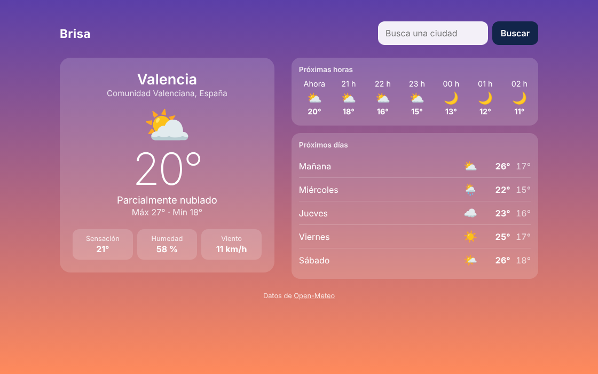

# Brisa 🌤️

App web del tiempo: busca una ciudad y muestra el tiempo actual, las próximas 12 horas y los próximos 5 días. Los colores de la página cambian según el momento del día en esa ciudad (mañana, tarde, atardecer y noche).



## Qué hace

- Busca cualquier ciudad y muestra la temperatura, el estado del cielo, la sensación térmica, la humedad y el viento.
- Previsión por horas (12 h) y por días (5 días).
- Recuerda la última ciudad buscada con `localStorage`, así al volver a abrir la página aparece directamente.
- Cambia los colores de fondo según la hora local de la ciudad, no la del usuario.
- Muestra mensajes claros si la ciudad no existe o si no hay conexión.
- Diseño pensado primero para móvil; en ordenador se reparte en dos columnas.

## Tecnologías

- HTML, CSS y JavaScript, sin librerías ni frameworks.
- `fetch` con `async/await` para pedir los datos.
- [Open-Meteo](https://open-meteo.com/): API del tiempo gratuita y sin clave.
  - Geocodificación: nombre de la ciudad → coordenadas.
  - Previsión: coordenadas → tiempo actual, por horas y por días.

## Cómo funciona

1. El usuario escribe una ciudad y envía el formulario.
2. `buscarCiudad()` pide sus coordenadas a la API de geocodificación.
3. `pedirPrevision()` pide el tiempo de esas coordenadas, con `timezone=auto` para recibir las horas en hora local de la ciudad.
4. `pintarTiempo()` rellena la página y cambia el atributo `data-momento` del `<body>`. En el CSS, cada momento del día tiene sus propias variables de color.

## Estructura

```
brisa/
├── index.html
├── css/
│   └── estilos.css
└── js/
    └── app.js
```

## Cómo usarla

No necesita instalación ni servidor: basta con abrir `index.html` en el navegador.

También se puede publicar gratis con GitHub Pages: en el repositorio, *Settings → Pages → Deploy from a branch → main*.

## Autor

Andrés Ruiz Torres · [GitHub](https://github.com/Andresxn782) · [LinkedIn](https://www.linkedin.com/in/andres-ruiz-torres-806336350/)
